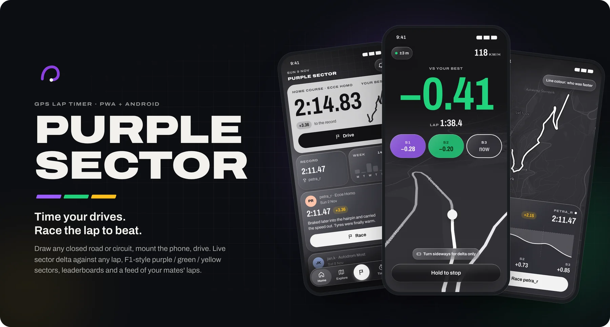
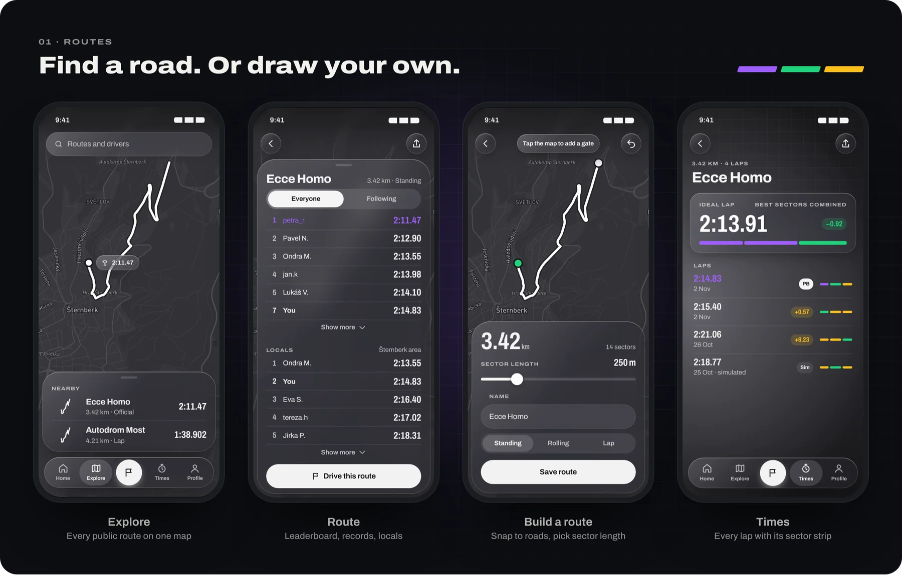
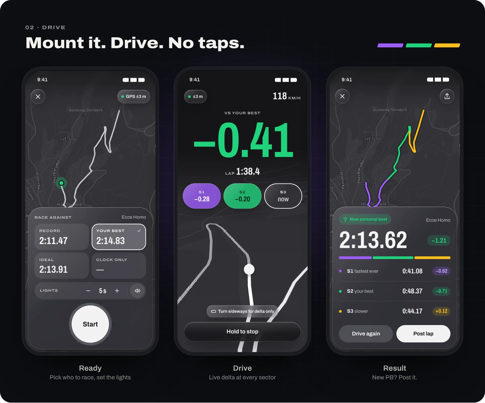
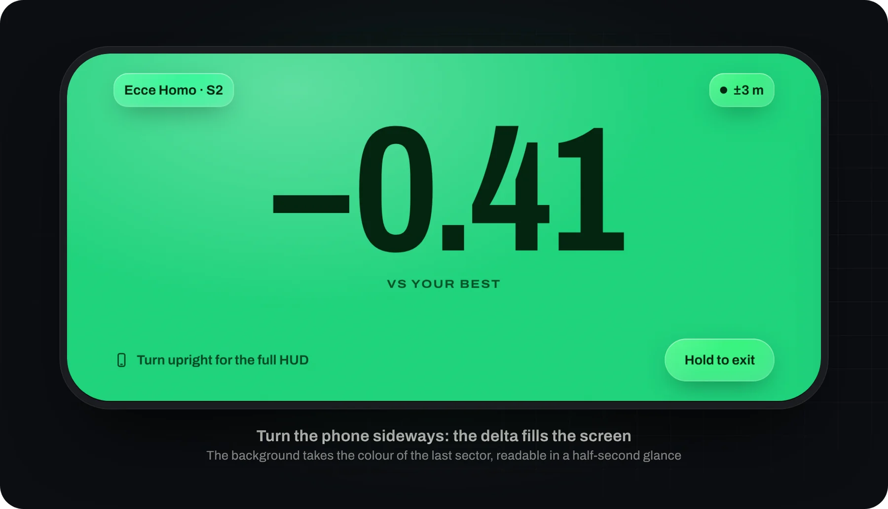
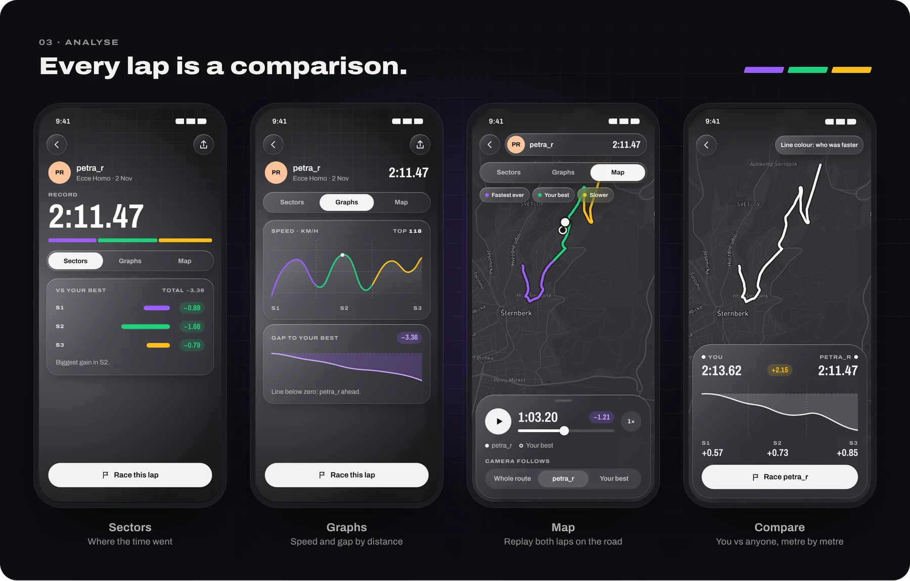
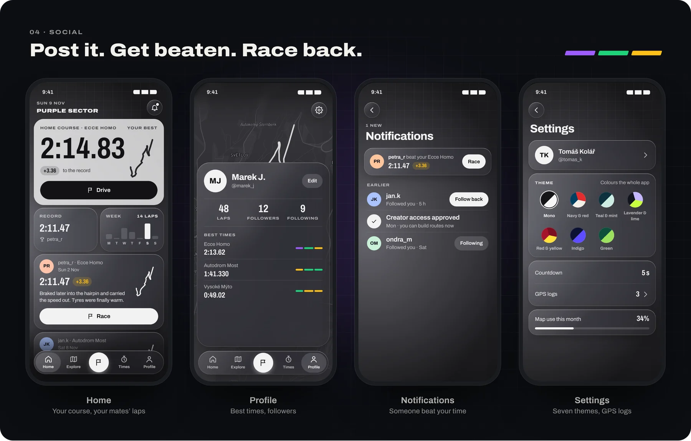
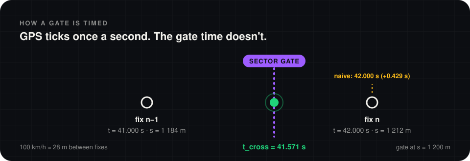
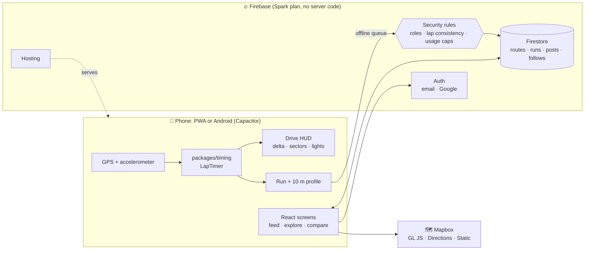
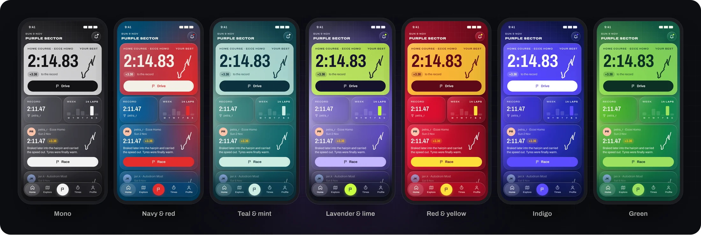

<div align="center">



<br>

**A GPS lap timer for track days, hill-climbs and rally stages.**<br>
Draw your own route, mount the phone, drive. Get a live sector delta against any lap you choose,<br>
F1-style purple / green / yellow sectors, leaderboards, and a feed of your mates' laps to beat.

<br>

[](https://marek-f1-lap-timer.web.app)
[](https://github.com/marekjancikorbis/marek_f1_lap_timer/releases/latest/download/purple-sector.apk)


-9d5cff?style=flat-square)

</div>

---

## Contents

- [Why Purple Sector](#why-purple-sector)
- [Tour](#tour)
- [Sector colours](#sector-colours)
- [Under the hood: the timing engine](#under-the-hood-the-timing-engine)
- [Architecture](#architecture)
- [Seven themes](#seven-themes)
- [Getting started](#getting-started)
- [Deploying and releasing](#deploying-and-releasing)
- [Security and privacy](#security-and-privacy)
- [Performance](#performance)
- [Roadmap](#roadmap)
- [Docs](#docs)

---

## Why Purple Sector

Most lap timers know a fixed list of circuits. Purple Sector times **any road you draw**: a hill-climb, a closed rally stage, a karting track, the circuit at your next track day. The phone in its mount does the rest.

|  |  |
|---|---|
| 🛣️ **Your routes, not a track database** | Tap waypoints on a map, they snap to the road. Point-to-point or a lap, standing or rolling start, sectors every 50–1000 m. |
| ⏱️ **Live delta at every sector** | Race your PB, a friend's posted lap, your theoretical best or the route record. The delta updates at each sector gate. |
| 🚦 **F1-style starts** | 3–10 s countdown with lights and beeps. The lap starts when the car moves, so reaction time costs nothing. Jump the start by more than 10 m and you get **+5 s**. |
| 👀 **Eyes on the road** | Nothing to tap while moving except *hold to stop*. Turn the phone sideways and the delta fills the screen. |
| 📈 **Every lap is a comparison** | Sectors, speed and gap graphs by distance, and a map replay with both cars on the road. |
| 🏆 **Leaderboards and a feed** | Post a lap to the route's leaderboard, follow drivers, get told when someone beats your time, then race their lap. |
| 📴 **Works with poor signal** | Everything a drive needs is cached before it starts. Results sync when the signal comes back. GPS dropouts never end a run. |
| 📱 **PWA and Android** | One codebase. The Android app keeps timing with the screen off (background GPS with a notification). |

---

## Tour

<p align="center"></p>

<p align="center"></p>

<p align="center"></p>

<p align="center"></p>

<p align="center"></p>

<sub>Screens are from the design mockups in <code>apps/web/design/redesigns</code> (the <b>Telemetry</b> design, Mono theme), which the app is built from 1:1. The route is the real Ecce Homo hill-climb road out of Šternberk; the drivers and times are sample data.</sub>

---

## Sector colours

Every time in the app wears its three-sector strip. Colour is never the only signal: each one comes with a label, a sign or a position.

| | Public route | Private route |
|---|---|---|
| 🟪 **Purple** | Faster than the route record *and* your own best | Faster than your personal best for that sector |
| 🟩 **Green** | Faster than your own personal best | Faster than the same sector of the lap you're racing |
| 🟨 **Yellow** | Slower | Slower |
| 🟥 **Red banner** | Jump start, +5.0 s | Jump start, +5.0 s |

The delta always compares with the lap you race. Records and PBs are downloaded before the drive, so the colours work offline, and saved laps keep the colours they had when driven.

---

## Under the hood: the timing engine

The engine is a pure TypeScript package with no UI, [`packages/timing`](packages/timing/src). `LapTimer` takes a stream of GPS fixes and accelerometer samples and emits `armed`, `countdown`, `started`, `jumpStart`, `sector`, `lapComplete`, `finished` and `invalidated`.

### Where am I on the route?

The route polyline is resampled every ~2 m. Each fix is projected onto it to get **s** (distance along the route) and **e** (lateral offset). The search only looks in a window around the last known `s`, so routes that cross themselves and loops where start = finish just work. Stay more than ~30 m off the line for a few seconds and the run is invalidated.

### Gates between the GPS ticks

Phone GPS updates at about 1 Hz: at 100 km/h that is one fix every ~28 m. Taking the time of the first fix past the line would be up to a second off, so the engine interpolates on the **GPS timestamps**:

<p align="center"></p>

$$
t_{\text{cross}} = t_{n-1} + \frac{s_{\text{gate}} - s_{n-1}}{s_n - s_{n-1}} \cdot (t_n - t_{n-1})
$$

Then for every sector *k*, against the reference lap you're racing:

```
split_k  = t_cross_k − t_start          elapsed time at the sector end
sector_k = split_k − split_(k−1)
delta_k  = split_k − ref.split_k         negative = ahead
```

### How accurate is it?

`simulateTrackDrive` models corner-limited speed, braking and a 2.5 m drifting GPS error, and `test/accuracy.test.ts` keeps the numbers honest:

| Simulated drive | Gates | RMS error | p95 | Max |
|---|---:|---:|---:|---:|
| Rally stage, 1 Hz GPS | 280 | 73 ms | 146 ms | 244 ms |
| Rally stage, 5 Hz GPS | 280 | 66 ms | 130 ms | 259 ms |
| Circuit, 1 Hz GPS | 260 | 74 ms | 141 ms | 276 ms |
| Circuit, 5 Hz GPS | 260 | 72 ms | 137 ms | 226 ms |

The surprise: **5 Hz is no better than 1 Hz**. The error comes from GPS position, not from interpolation (with perfect GPS it stays under 60 ms), so fancier curve fitting isn't worth building. Only better fixes help, such as an external 10–25 Hz GNSS receiver.

### Jump starts without false penalties

A phone sitting still sees its GPS position wander 3–10 m, so comparing raw positions with a 10 m limit would hand out penalties to drivers who never moved. Instead, the engine:

1. **Anchors** the start by averaging fixes during the countdown, and captures the accelerometer baseline (gravity and mount angle).
2. Counts **motion** only when two independent signals agree: sustained forward acceleration above ~0.1 g for over 300 ms (door slams and revs are filtered out) **and** GPS Doppler speed above ~1.5 m/s (Doppler doesn't drift with the position).
3. Measures the distance moved before GO by **integrating Doppler speed**, forward along the route only, so rolling back on a hill is never penalised.
4. Gives **+5 s only above 10 m**, and the benefit of the doubt whenever the signals disagree.

A jump-started lap is timed from GO, the penalty goes into sector 1 so no split or colour can profit from it, and the run stays valid.

---

## Architecture



There is **no backend code at all**. Everything a server would usually do lives in [`firestore.rules`](firestore.rules): who may publish a route, that users can never change their own role, that a posted lap is self-consistent (increasing splits, total = last split, penalty applied), and that the Mapbox usage counters only ever go up by one and stop at the cap. Leaderboards, sector records and the feed are computed when they are read.

### Tech stack

| Layer | What |
|---|---|
| App | React 18, TypeScript, Vite, React Router, `vite-plugin-pwa` |
| Timing | `packages/timing`: pure TypeScript, tested with Vitest, GPS fixtures and a drive simulator |
| Maps | Mapbox GL JS (dark style), Mapbox Directions for road snapping, Static Images for cards |
| Backend | Firebase Auth, Firestore with security rules, Firebase Hosting |
| Android | Capacitor 7: background geolocation, keep-awake, native Google sign-in, share sheet, local notifications |
| On-device ML | TensorFlow.js + NSFW.js checks profile photos on the phone before upload |
| Type | Archivo (variable), bundled |
| CI/CD | GitHub Actions: tests, rules tests, deploy to Hosting, signed APK as a GitHub release |

### Project layout

```
apps/web/                 the app: screens, map, drive HUD
├─ src/screens/           Feed, Explore, Drive, PreDrive, RouteBuilder, Compare, LapDetail, …
├─ src/drive/             drive controller, sounds, GPS logs
├─ src/lib/               data access, Firebase, Mapbox, themes, usage caps
├─ src/styles/            tiles.css (the design system), themes.css (generated)
├─ design/                mockups of every screen, MOTION.md
└─ android/               Capacitor's Android project (built in CI)
packages/timing/          the timing engine + tests + simulator
firestore.rules           the whole "backend"
tests/rules.test.ts       security rules tests (Firestore emulator)
scripts/                  seed scripts for local perf testing
.github/workflows/        deploy.yml (Hosting), android.yml (APK release)
```

---

## Seven themes

Pick one in Settings. Sector colours stay the same in every theme, because purple has to mean purple.

<p align="center"></p>

The themes are generated from the mockup palettes (`apps/web/design/redesigns/tools/app_themes.py`) and applied before first paint, so there is no flash of the wrong colours.

---

## Getting started

**Requirements:** Node 22, npm. Java 11+ only for the security rules tests.

```bash
npm install

npm run dev                    # the app on http://localhost:5173
npm test                       # timing engine tests
npm run test:rules             # Firestore rules tests (starts the emulator)
npx tsc --noEmit -p apps/web   # typecheck
npm run build                  # production build
```

**Against local emulators** instead of the live project:

```bash
npx firebase emulators:start --only auth,firestore --project marek-f1-lap-timer
VITE_EMULATORS=1 npm run dev
node scripts/seed-perf.mjs 200   # optional: a driver with 200 laps
```

**No car needed:** the pre-drive screen has a *Simulate the drive* switch that replays a synthetic or recorded drive through the real engine, so you can test the whole drive flow at your desk.

---

## Deploying and releasing

| | How |
|---|---|
| **Web** | Every push to `main` runs the engine tests and rules tests, builds, deploys the Firestore rules, then Firebase Hosting ([`deploy.yml`](.github/workflows/deploy.yml)). By hand: `npx firebase deploy --only hosting` (plus `firestore:rules` / `firestore:indexes` when they change). |
| **Android** | When the app changes, CI builds a **signed APK** and publishes it as the latest GitHub release ([`android.yml`](.github/workflows/android.yml)). The PWA's *Get the Android app* button links straight to it. |
| **Capacitor plugins** | After adding one: `npx cap sync android` in `apps/web` and commit the changed Gradle files. |

Secrets used by CI: `FIREBASE_SERVICE_ACCOUNT`, `ANDROID_KEYSTORE`, `ANDROID_KEYSTORE_PASSWORD`. The Android signing key must never change, or phones refuse the update and Google sign-in stops working.

---

## Security and privacy

- **Private by default.** Routes are private until published, laps are private until posted.
- **Raw GPS traces never leave their owner.** Comparisons with other people use only the distance-indexed profiles (time and speed every 10 m).
- **Roles are enforced by the server**, not the UI: driver → creator (granted by an admin) → admin (granted by the owner) → owner. Every grant writes an audit entry. A creator can publish 1 route, an admin 5.
- **Warnings where it matters**: publishing a route warns that its start and end become public (routes that start at home).
- **Mapbox costs are capped** just under the free tier (45k map loads, 90k Directions requests, 45k static maps a month). At the cap the app shows *Monthly limit reached, back on 1 Dec* instead of a bill.

---

## Performance

Measured on a seeded driver with 200 laps, phone emulation with 4× CPU slowdown on "Fast 4G" ([`PERFORMANCE_PLAN.md`](PERFORMANCE_PLAN.md)):

| | Before | After |
|---|---:|---:|
| Data per Feed / Drive / Times open | ~13 MB | **~0.1 MB** |
| Firestore reads per open | 200 | **1** |
| *My times*, first open | 11.4 s | **1.1 s** |
| *My times*, open again | 44 s | **53 ms** |
| *Drive* tab | 40 s | **1.1 s** |
| Main JS chunk | 813 KB | **36 KB** + vendor chunks |
| Service worker precache | 3.18 MB | **1.27 MB** |

---

## Roadmap

- 🏁 **In-person racing**: two cars on the same route with a live gap to each other, a shared countdown for side-by-side starts, over Firebase Realtime Database ([`RACING_PLAN.md`](RACING_PLAN.md))
- 👻 A live ghost delta between sectors
- 📡 External 10–25 Hz GNSS receivers over Bluetooth (Android)
- 🎥 Video overlay export: time and delta burned into dashcam footage
- 🚗 Car profiles and classes
- 🍎 An iOS app (Capacitor is ready for it)

---

## Docs

| File | What's in it |
|---|---|
| [`PLAN.md`](PLAN.md) | What the app does and why. Timing rules in section 4; **section 9, Decisions made**, wins over anything older |
| [`apps/web/PRODUCT.md`](apps/web/PRODUCT.md) | Users, the in-car vs paddock moments, product principles |
| [`apps/web/DESIGN.md`](apps/web/DESIGN.md) | Visual design rules and tokens |
| [`apps/web/design/MOTION.md`](apps/web/design/MOTION.md) | The motion spec: springs, durations, reduced motion, what the drive screen may never do |
| [`PERFORMANCE_PLAN.md`](PERFORMANCE_PLAN.md) | Performance work, done and measured |
| [`RACING_PLAN.md`](RACING_PLAN.md) | Planned live racing between two cars |

---

> [!WARNING]
> **Track days and closed roads only.** Purple Sector is built for circuits, hill-climbs, karting and closed rally stages. Every driver accepts the terms before their first drive. Don't time yourself on public roads.

<div align="center">
<br>

<br><br>
<sub><b>Purple Sector</b> · purple means fastest ever</sub>
</div>
